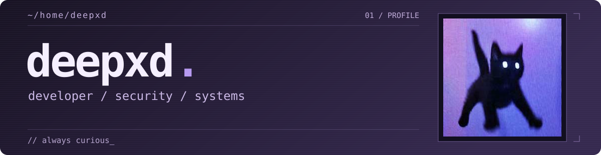
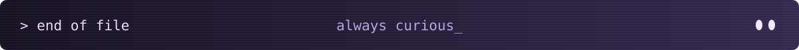

<p align="center">
  
</p>

<p align="center">
  
</p>

I'm **DeepXD**, a full-stack developer and student from Saudi Arabia. I enjoy building software, taking it apart, and figuring out how it works under the hood. I spend a lot of my time experimenting with security, automation, and performance.

### ~/work

- **CyberGuard** — A Windows security auditing tool focused on identifying insecure configurations and system security risks.
- **Security research** — Binary analysis, software internals, and responsible vulnerability disclosure.
- **Automation** — Building efficient tools and experimenting with concurrent systems.

### ~/about

```text
$ whoami
  deepxd

$ cat interests.txt
  full-stack development
  cybersecurity & reverse engineering
  automation & systems programming

$ echo $MOTTO
  Build it. Break it. Understand it. Improve it.
```

### ~/stack

**Languages**


**Full-stack**


**Security & low-level**


**Infrastructure**


<p align="center">
  <a href="https://github.com/DeeepXD">GitHub</a> ·
  <a href="https://discord.com/users/965202439038992404">Discord</a> ·
  <a href="mailto:a.aljohani@proton.me">Email</a>
</p>

<p align="center">
  
</p>
